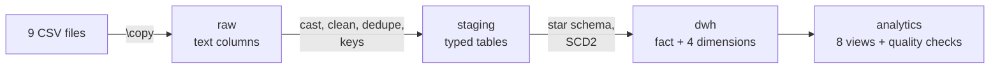
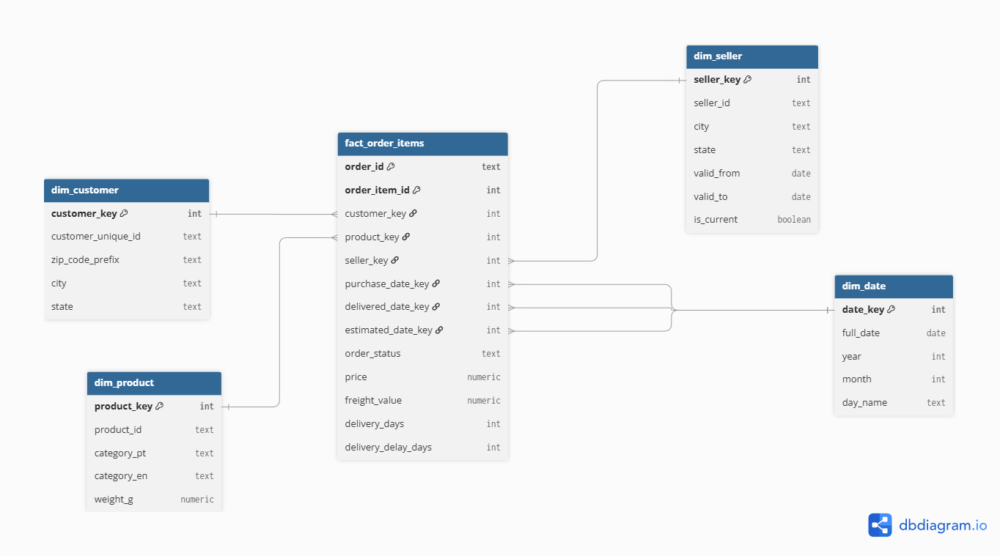
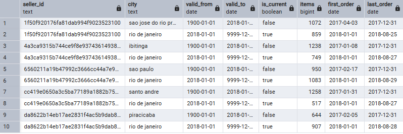
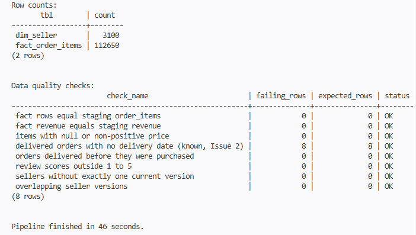
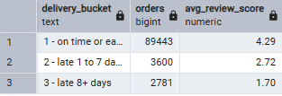

# Olist E-Commerce Data Warehouse (PostgreSQL)

A local data warehouse built in PostgreSQL from the Olist Brazilian e-commerce dataset. Raw CSV files go through a cleaning layer into a star schema with SCD Type 2 history, and the result answers business questions with SQL views. The whole thing rebuilds with one command.

## What this project shows

- Layered architecture: raw, staging, warehouse, analytics
- Dimensional modeling: star schema, surrogate keys, role-playing date dimension
- SCD Type 2 on a seller dimension, with a before/after proof
- A repeatable pipeline that stops at the first error and validates itself at the end
- Analytical SQL: CTEs, window functions, `FILTER`
- Documented data quality issues, tests for each layer, and measured query tuning

## Dataset

[Brazilian E-Commerce Public Dataset by Olist](https://www.kaggle.com/datasets/olistbr/brazilian-ecommerce) (Kaggle): about 100,000 orders from September 2016 to October 2018, spread over 9 related tables. The CSV files are not in this repo (see "How to run").

## Architecture



| Schema      | Purpose                                                                                     |
| ----------- | ------------------------------------------------------------------------------------------- |
| `raw`       | Data exactly as loaded from the CSVs, all text, no assumptions                              |
| `staging`   | Typed and cleaned tables with primary and foreign keys                                      |
| `dwh`       | Star schema: `fact_order_items` and `dim_customer`, `dim_product`, `dim_seller`, `dim_date` |
| `analytics` | Business views and a data quality view                                                      |



### Key design decisions

- **Grain of the fact table:** one row per order item (112,650 rows). Payments and reviews are per order, so joining them to the fact table would duplicate amounts. They are used in the analytics views at order level.
- **Customers:** `customer_id` changes with every order, so `dim_customer` has one row per `customer_unique_id` (96,096 rows).
- **Role-playing dimension:** `dim_date` is used three times by the fact table (purchase, delivery and estimated delivery dates), so there is one calendar and no copies.
- **SCD Type 2 on `dim_seller`:** each version has its own surrogate key and `valid_from`, `valid_to`, `is_current`. The fact table joins the seller version valid on the purchase date.

## SCD Type 2 demo

Olist has no history, so the project simulates it: five of the busiest sellers move to Rio de Janeiro on 2018-01-01. Orders placed before that date keep the old city, and later orders get Rio.



## How to run

Requirements: Windows with PowerShell, PostgreSQL 18 (with `psql`), and the Olist CSV files.

1. Create an empty database named `olist`.
2. Download the dataset from Kaggle and put the 9 CSV files in `data/`.
3. From the repo root, run:

```powershell
powershell -ExecutionPolicy Bypass -File .\run_pipeline.ps1
```

The script asks for the Postgres password (or reads the `PGPASSWORD` variable). If `psql.exe` is not at `C:\Program Files\PostgreSQL\18\bin\psql.exe`, pass `-Psql "C:\path\to\psql.exe"`. The full rebuild takes about one to two minutes.

The pipeline runs every `.sql` file under `sql/` in folder and file-name order, stops at the first error, and ends by printing 8 data quality checks. It can be run again at any time and gives the same result, because every script drops and recreates what it builds. Keep scratch queries outside `sql/`.



## Repo structure

```
data/                 # CSVs (gitignored)
docs/                 # Issues log, test reports, ER diagram, performance notes
sql/
  01_raw/             # Schemas, raw tables, CSV load
  02_staging/         # Typing, cleaning, keys, simulated seller changes
  03_warehouse/       # Dimensions, SCD2, fact table
  04_analytics/       # Views, data quality checks, indexes
run_pipeline.ps1      # One-command rebuild
```

## Key findings

| Finding                                     | Evidence                                                                                         |
| ------------------------------------------- | ------------------------------------------------------------------------------------------------ |
| Late deliveries sharply lower review scores | On time or early: 4.29 (89,443 orders). Late 1 to 7 days: 2.72. Late 8+ days: 1.70.              |
| Most customers buy only once                | 2,801 of 93,358 customers (3.00%) ordered twice or more.                                         |
| Credit card dominates payments              | 78.34% of payment value, then boleto at 17.92%.                                                  |
| Revenue grew through 2017, then plateaued   | About 40k in October 2016, 988k in November 2017, and between 826k and 978k every month of 2018. |



## Data quality and testing

Every layer has a written test report with the queries and their results:

| Document                                        | Content                                                    |
| ----------------------------------------------- | ---------------------------------------------------------- |
| [`data_issues.md`](docs/data_issues.md)         | 8 issues found in the raw data and how each one is handled |
| [`staging_tests.md`](docs/staging_tests.md)     | 10 tests on the staging layer                              |
| [`warehouse_tests.md`](docs/warehouse_tests.md) | 8 tests on the star schema                                 |
| [`scd2_tests.md`](docs/scd2_tests.md)           | 8 tests on the SCD2 history and the pipeline               |
| [`analytics_tests.md`](docs/analytics_tests.md) | 7 tests on the views and the data quality checks           |
| [`performance.md`](docs/performance.md)         | Query plans before and after indexing                      |

Some things the tests caught:

- A join that sent every order to the current seller version (and lost the history) while all row counts and sums still passed. Only the before/after demo exposed it.
- `review_id` looked duplicated (814 repeats), but it is the same review attached to different orders, so the right key is `(review_id, order_id)`.
- 8 orders marked `delivered` have no delivery date. They are kept and flagged by a quality check.

## Performance

Two filters were measured with `EXPLAIN (ANALYZE, BUFFERS)` before and after adding indexes:

| Query                                      | Pages read  | Time               |
| ------------------------------------------ | ----------- | ------------------ |
| Seller revenue (index on the foreign key)  | 1,743 to 38 | 9.2 ms to 1.9 ms   |
| Reviews of one order (index on `order_id`) | 1,856 to 4  | 10.7 ms to 0.06 ms |

The tables are small, so the absolute gain is small. The point is that the plan changed from reading the whole table to reading a few pages, and that gap grows with table size. Details in [`performance.md`](docs/performance.md).

## Trade-offs and limitations

- **Full refresh instead of incremental loads.** Every run rebuilds everything from the CSVs. It is simple and safe at this size (about 100k orders), but would be slow on large data.
- **Simulated history.** The SCD2 changes are generated by a script, since the dataset has no history. The selection is deterministic.
- **Payments and reviews are not in the warehouse.** The analytics views read them from `staging`. A production model would add an order-level fact table.
- **Windows and PowerShell only.** The runner and the default `psql` path are Windows-specific.
- **No orchestrator yet.** Scheduling, retries and alerts are not covered.

## Tech stack

PostgreSQL 18, SQL (PL-free: CTEs, window functions), psql with `\copy`, PowerShell, Git
